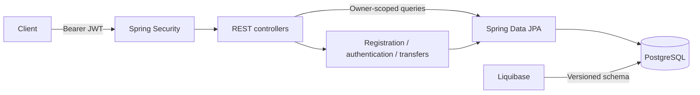

# Demo Bank

[](https://github.com/ursusandwolf/demo-bank/actions/workflows/ci.yml)


A banking REST API built to explore Spring Security, resource ownership and transactional money transfers. The project demonstrates how authentication, authorization and persistence work together in a Java backend.

**Maintenance update — October 2026:** consolidated development into `dev`, repaired authentication and persistence, added regression coverage and automated verification. See the [review report](docs/CODE_REVIEW.md) and [changelog](docs/CHANGELOG.md).

> A portfolio and learning project. It is not intended to handle real money or personal banking data.

## What it does

- Registers users with BCrypt passwords and a server-assigned `USER` role.
- Authenticates with signed JWT access tokens that expire after 15 minutes.
- Rotates refresh tokens, rejecting reuse of the previous token; refresh tokens expire after seven days.
- Checks blocked, locked and expired user accounts for login, JWT requests and refresh.
- Restricts administrative endpoints to `ADMIN` and account queries to their owner.
- Transfers money atomically, updating both balances and recording both sides of the transfer.
- Rejects invalid amounts, insufficient funds, inactive accounts and currency mismatches.
- Uses optimistic locking to detect concurrent account updates and JSON errors with trace IDs.

## Technology

| Area | Tools |
| --- | --- |
| Runtime | Java 21, Spring Boot 3.5.16 |
| Security | Spring Security, BCrypt, JJWT 0.13.0 |
| Persistence | Spring Data JPA, PostgreSQL 16, Liquibase |
| Tests | JUnit 5, MockMvc, AssertJ, H2 |
| Delivery | Maven, Docker Compose, GitHub Actions, Dependabot |

## Run locally

Install **Java 21**, **Maven 3.6.3+** and **Docker with Compose**. Commands below use a POSIX shell; PowerShell configuration is shown separately.

```bash
git clone https://github.com/ursusandwolf/demo-bank.git
cd demo-bank
docker compose up -d --wait

# Generate a private Base64 signing key. Keep the same key across restarts.
export JWT_SECRET="$(openssl rand -base64 48 | tr -d '\n')"
mvn spring-boot:run
```

PowerShell alternative for generating and exporting the key:

```powershell
$keyBytes = New-Object byte[] 48
$rng = [System.Security.Cryptography.RandomNumberGenerator]::Create()
$rng.GetBytes($keyBytes)
$rng.Dispose()
$env:JWT_SECRET = [Convert]::ToBase64String($keyBytes)
mvn spring-boot:run
```

Check the running application:

```bash
curl http://localhost:8080/api/public/health
# {"status":"UP"}
```

The Compose database listens on `127.0.0.1:5432` and persists data in a named volume. `docker compose down` stops it without removing stored data.

| Variable | Default | Purpose |
| --- | --- | --- |
| `JWT_SECRET` | Required | Base64-encoded random key of at least 32 bytes; the example generates 48 |
| `DATABASE_URL` | Local PostgreSQL database `bank` on port 5432 | JDBC connection URL |
| `DATABASE_USERNAME` | `postgres` | Local database username |
| `DATABASE_PASSWORD` | `postgres` | Local database password |
| `LIQUIBASE_CONTEXTS` | `default` | Set to `demo` only when you want the historical demo-user seed |

Local database credentials are for development. New databases contain no demo users under the default context. Register your own user. Tests supply a separate public test key and need no environment variables or database server.

## Try the API

Register a user:

```bash
curl -i -X POST http://localhost:8080/api/auth/register \
  -H 'Content-Type: application/json' \
  -d '{"email":"alice@example.com","password":"password123","firstName":"Alice","lastName":"Example"}'
```

Log in and copy `accessToken` and `refreshToken` from the response:

```bash
curl -X POST http://localhost:8080/api/auth/login \
  -H 'Content-Type: application/json' \
  -d '{"email":"alice@example.com","password":"password123"}'

export ACCESS_TOKEN='paste-accessToken-here'
curl http://localhost:8080/api/users/me -H "Authorization: Bearer $ACCESS_TOKEN"
curl http://localhost:8080/api/accounts -H "Authorization: Bearer $ACCESS_TOKEN"
```

Refresh uses the token as a **plain text body**, not a JSON object. Save the replacement refresh token returned in the response:

```bash
curl -X POST http://localhost:8080/api/auth/refresh \
  -H 'Content-Type: text/plain' --data-raw 'paste-refreshToken-here'
```

Registration creates a user, not a funded account. To exercise transfers locally, follow the [demo account setup](docs/DOCUMENTATION.md#demo-accounts). Account creation, deposits and administrative role assignment are deliberately outside the public API.

## API at a glance

| Method | Route | Access |
| --- | --- | --- |
| GET | `/api/public/health` | Public |
| POST | `/api/auth/register` | Public |
| POST | `/api/public/register` | Public registration alias |
| POST | `/api/auth/login` | Public |
| POST | `/api/auth/refresh` | Valid refresh token |
| GET | `/api/private/hello` | `USER` or `ADMIN` |
| GET | `/api/users/me` | Authenticated |
| GET | `/api/users/count` | `USER` or `ADMIN` |
| GET | `/api/admin/users` | `ADMIN` |
| GET | `/api/accounts` | Authenticated; own accounts |
| GET | `/api/accounts/{number}` | Owner; otherwise 404 |
| GET | `/api/accounts/{number}/transactions` | Own history; otherwise empty page |
| POST | `/api/transfers` | Authenticated; must own source account |

See [API details and examples](docs/DOCUMENTATION.md) for transfers, pagination and error responses.

## Verify

```bash
mvn --batch-mode --no-transfer-progress verify
```

The suite checks registration, authentication, role restrictions, account ownership, transaction history, transfers and token lifecycle. H2 runs the Liquibase migrations with Hibernate schema validation enabled. CI runs the same verification on pushes and pull requests to `main` and `dev`.

H2 is not a substitute for PostgreSQL integration testing. PostgreSQL concurrency and deployment checks remain on the [roadmap](docs/PROJECT_CONTEXT.md#next-steps).

## How it fits together



Code is organized by feature under `com.example.bank`: `auth`, `security`, `user`, `account`, `transfer` and `common`. Controllers return DTOs rather than password-bearing entities. Balance changes and transaction records share one transaction; optimistic conflicts return 409 instead of silently overwriting a balance.

## Project workflow

`main` presents the reviewed snapshot. `dev` is the integration branch. Use short-lived feature branches and delete them after merging. [Contributing](CONTRIBUTING.md) describes the checks and branch workflow.

- [Architecture and data model](docs/UML.md)
- [API documentation](docs/DOCUMENTATION.md)
- [Review findings and fixes](docs/CODE_REVIEW.md)
- [Project status and next steps](docs/PROJECT_CONTEXT.md)
- [Changelog](docs/CHANGELOG.md)

Current scope does not include a frontend, account provisioning, deposits, multi-currency conversion, payment integrations or production deployment. CORS allows `http://localhost:3000`; adapt it when adding a client application.
