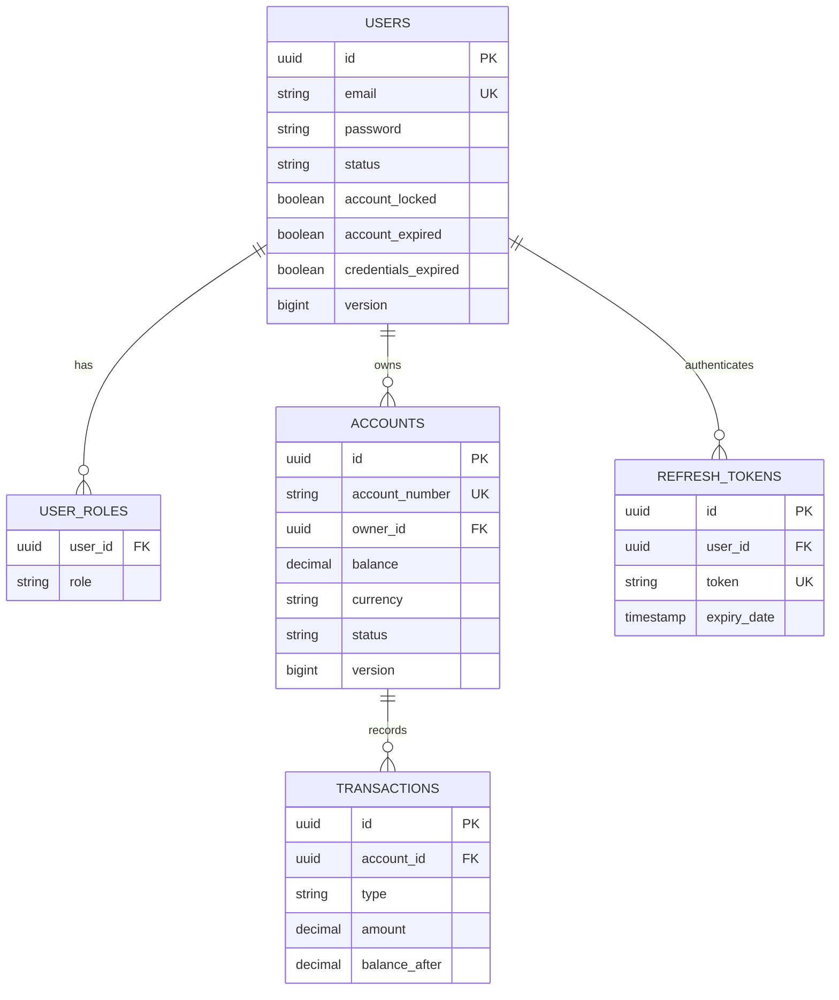
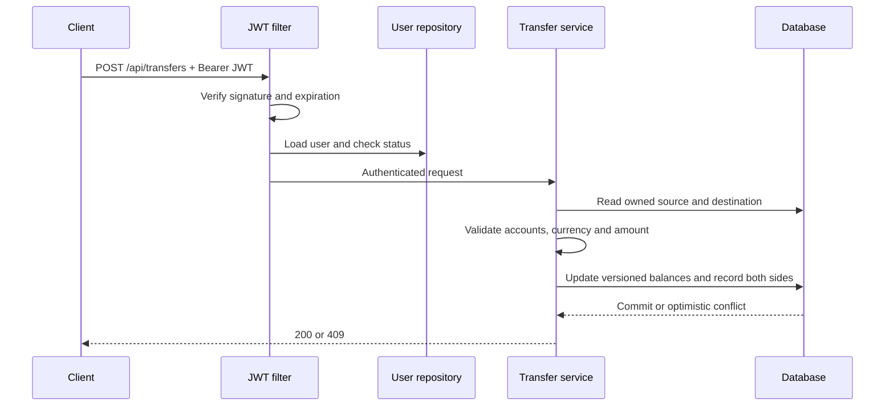

# Architecture and data model

## Packages

| Package | Responsibility |
| --- | --- |
| `auth` | Registration alias, login, refresh and private example endpoint |
| `security` | Security chain, user lookup, JWT validation and refresh-token lifecycle |
| `user` | User entity, registration service, profiles and administrative queries |
| `account` | Account/history entities, owner-scoped repositories and DTOs |
| `transfer` | Atomic balance changes and paired transaction records |
| `common` | Health endpoint and application error responses |

## Persistence

Passwords are BCrypt hashes. `refresh_tokens.token` holds a SHA-256 hash of a high-entropy opaque token. User and account versions support optimistic locking. Audit timestamps are populated by Spring Data JPA auditing. Liquibase owns schema changes; Hibernate validates rather than creates the schema.

## Request flow

Account history queries constrain both account number and owner email. Refresh rotation uses a pessimistic row lock and replaces the stored token hash inside a transaction. The tests run migrations on H2; verification against PostgreSQL remains separate work.
